# Smakr — Editorial Feed & Full-Screen Map
## Design and Performance Audit

**Prepared for:** Gemini / Argon review
**Product:** Smakr Oslo Food Radar (`frontend/`)
**Branch:** `feat/editorial-feed-and-map-mode` (latest commit `222a330` + uncommitted design/perf pass)
**Date:** 11 November 2026
**Build audited:** production `next build` + `next start -p 3010` (Next.js 15.5.28)

---

[TOC]

---

## 0. How to use this document

This document is written so it can be handed to another model or designer without extra context. It contains:

1. A design critique of every surface in the new editorial feed and full-screen map mode, with screenshots.
2. A code-level performance audit that explains **why the map still feels laggy** even after the recent optimisation pass.
3. A prioritised change plan (P0/P1/P2) with expected impact, effort, and acceptance criteria.

Every screenshot in this document was captured from the **production build**, not the dev server. Images are embedded in the HTML and PDF versions. Source PNGs and optimised JPEGs live in `docs/audit-assets/` and `docs/audit-assets/web/`.

> **Important measurement caveat.** Screenshots and frame numbers were captured in headless Chromium 153 on Windows using **SwiftShader (CPU rasterisation)** because the machine has no usable GPU in headless mode. Absolute frame rates are therefore much worse than a real iPhone/Android device. They are still useful because (a) the same build, viewport, and interactions were used for every comparison, and (b) the attribution tests isolate which code causes the cost. Treat the numbers as **relative evidence and upper bounds**, not as device benchmarks.

---

## 1. Executive summary

The new feed and map mode have a strong editorial point of view: warm paper, full-bleed food photography, a sticker-like map language, and a dock that feels like a physical tray of cards. The direction is right. The execution is not finished.

### The five design problems that matter most

| # | Problem | Where it shows up |
|---|---|---|
| D1 | **The map card has a dead middle.** It is 56% of the screen tall, but its content is split between a top chip row and a bottom text block, leaving ~180–220px of empty photo in between. It reads as a photo with captions, not a card. | `14-mobile-map-card.png`, `06-desktop-map-card.png` |
| D2 | **The map card is clipped at the bottom.** It is translated 22px below the viewport (`translate-y-[22px]`) so the bottom rounded edge, safe-area padding, and part of the CTA row are off-screen. | `MapNeighborhoodDock.tsx:713` |
| D3 | **On desktop, the dock escapes the map pane.** The map is 835px wide, but the dock measures 1440px wide because the map container becomes `lg:static`. The card therefore floats over the feed/venue-detail pane and duplicates the open venue. | `HomeView.tsx:863–910`, `06`/`07` |
| D4 | **The feed leaves holes.** A full-width pop-up card (`col-span-full`) is followed by a single card in a two-column grid, leaving half a row empty under the hero. The same content (Double Biscott / Mint on Wheels) repeats in the hero, the matcha lane, and the pop-up lane. | `16-desktop-feed-tall.png`, `17-mobile-feed-tall.png`, `HomeView.tsx:513/538/560/581/611` |
| D5 | **The floating Feed slider covers content.** It is absolutely positioned over the scroller with no reserved lane, so it sits on top of the weekly pick banner and the pop-up cards at common scroll positions. | `03-desktop-feed-scrolled.png`, `17-mobile-feed-tall.png` |

### The five performance problems that matter most

| # | Problem | Evidence |
|---|---|---|
| P1 | **32 DOM markers each carry an SVG morphology + drop-shadow filter.** During zoom-in this is the dominant cost. | Removing the filter lifts zoom p50 from **84ms → 30ms**; hiding pins gives **18ms**. |
| P2 | **`renderWeeklyMarker()` rebuilds the mascot DOM on every `zoom` event** (`innerHTML = ""` then recreate image, badge, listener). | 27 child mutations and 205 marker style mutations in one 800ms fly. `MapRadarView.tsx:1202/1369`. |
| P3 | **CSS transitions are continuously retriggered by JS.** Pins have `transform .22s` and carousel cards have `transform/opacity 180ms`, while JS writes those same properties every zoom/scroll frame. The transition never settles, so elements lag behind the camera/scroll. | `MapRadarView.tsx:374`, `MapNeighborhoodDock.tsx:104`. |
| P4 | **The focused card animates `width` and `height`.** That forces layout + paint every frame, exactly while MapLibre is loading tiles and moving the camera. Expansion starts ~340ms after selection even with no map flight. | `MapNeighborhoodDock.tsx:707–710`. |
| P5 | **The feed is heavy.** ~3,894 DOM nodes, 229 `` elements, 13,167px of scroll content, and a persistent overlay on top. | `probe-audit` / `probe-frames` results. |

**Bottom line:** the map lag is not primarily MapLibre or the tile provider. It is the **marker decoration layer**: SVG filters, per-frame DOM writes, and a mascot that is rebuilt every zoom frame. Fix those three and the map will feel dramatically smoother before any tile or style work.

---

## 2. Method and environment

| Item | Value |
|---|---|
| Build | `npx next build`, then `npx next start -p 3010` |
| Route bundle | `/` = **51.5 kB** route, **446 kB** first-load JS, 103 kB shared |
| Browser | Chromium 153 headless (`--enable-unsafe-swiftshader --use-angle=swiftshader`) |
| Desktop viewport | 1440 × 950, DPR 1 |
| Mobile viewport | 390 × 844, DPR 2 (screenshots), DPR 1 for frame measurements |
| Data | Live Supabase data already loaded by the app |
| Interaction harness | Chrome DevTools Protocol: click card, sample `requestAnimationFrame`, `PerformanceObserver` (`longtask`, `long-animation-frame`), DOM geometry |
| Screenshot tool | `Page.captureScreenshot` (PNG), then mozjpeg q82 for embedding |

### What was measured

- **Frame interval** between consecutive `requestAnimationFrame` callbacks. `p50` is the typical frame, `p95` the slow tail. 16.7ms = 60fps; >34ms = visibly janky.
- **Long tasks** (>50ms) and **Long Animation Frames** (LoAF) with `blockingDuration` and `styleAndLayout` time.
- **DOM geometry**: card, dock, map canvas, feed scroller, pin rects.
- **Mutation counts** on map markers during a controlled `flyTo`.
- **Attribution tests**: same zoom gesture with (a) baseline, (b) SVG filter removed, (c) weekly marker hidden, (d) all pins hidden.

### Initial load (production, localhost)

| Metric | Value |
|---|---|
| TTFB | **150ms** |
| First paint / FCP | **464ms** |
| DOMContentLoaded | **484ms** |
| Map idle cadence | **17ms p50** (~59fps) |
| Feed idle cadence | 16ms p50, 138ms p95 (image decode spikes) |

Initial load is healthy. The problem is interaction, not boot.

---

## 3. Surface inventory

| # | Surface | Route / state | Screenshot |
|---|---|---|---|
| 1 | Desktop split (feed + map) | `/` | `01-desktop-split.png` |
| 2 | Desktop full feed, top | `/?view=feed` | `02-desktop-feed-top.png` |
| 3 | Desktop full feed, scrolled | `/?view=feed`, scroll 780 | `03-desktop-feed-scrolled.png` |
| 4 | Desktop map, resting | `/?view=map` | `05-desktop-map.png` |
| 5 | Desktop map, focused card | `/?view=map`, card tap | `06-desktop-map-card.png` |
| 6 | Desktop venue detail | card CTA → detail pane | `07-desktop-venue-detail.png` |
| 7 | Desktop filter drawer | `/?view=feed`, Filters | `08-desktop-filters.png` |
| 8 | Mobile feed, top | `/?view=feed` | `09-mobile-feed-top.png` |
| 9 | Mobile feed, scrolled | `/?view=feed`, scroll 760 | `11-mobile-feed-scrolled.png` |
| 10 | Mobile filter drawer | `/?view=feed`, Filters | `12-mobile-filters.png` |
| 11 | Mobile map, resting | `/?view=map` | `13-mobile-map.png` |
| 12 | Mobile map, focused card | `/?view=map`, card tap | `14-mobile-map-card.png` |
| 13 | Mobile venue detail | card CTA → bottom sheet | `15-mobile-venue-detail.png` |
| 14 | Desktop feed rhythm, full height | 1440 × 2300 | `16-desktop-feed-tall.png` |
| 15 | Mobile feed rhythm, full height | 390 × 2600 | `17-mobile-feed-tall.png` |

### State model relevant to the audit

- `viewMode`: `split | feed | map`
- `selectedVenue`: shared by pins, the dock card, the venue detail pane, and the bottom sheet
- `feedMode`: `food | places`
- `feedLayout`: `grid | list` (persisted default `grid`)
- `mobileSheetState`: `peek | half | full`

The audit focuses on `feedMode = food`, `feedLayout = grid`, and `viewMode = map`.

---

## 4. Design audit

### 4.1 Desktop split — good bones, weak mapping between panes

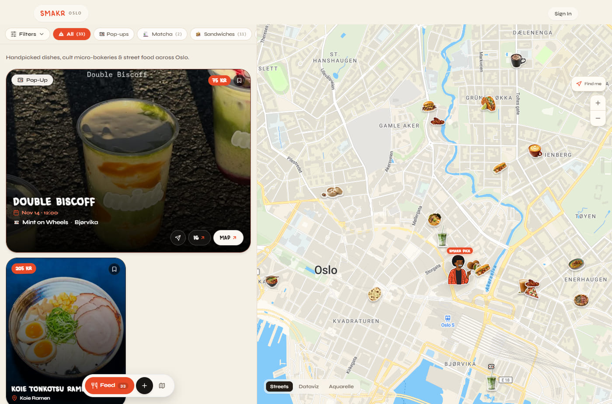

**What works:** the two-pane composition is clear, the feed cards are legible at 604px, and the map establishes place immediately.

**Problems:**

1. **The map can sit pinless while it loads.** Markers are attached only after `map.on("load")` and then `requestIdleCallback` (`MapRadarView.tsx:1280–1292`). In the first capture at ~7s the split map showed zero pins; a later capture at 14s showed 20 pins in the same viewport. On a slow connection the right pane reads as a static illustration for several seconds. Add a pin skeleton/cluster placeholder and attach markers as soon as the style is ready.
2. **The feed pane and map pane use different card scales.** The same photo-led card is rendered ~1000px wide in the full feed and ~604px wide in split; in split its height drops to ~430px, so the crop and type scale change with the pane. The map has no equivalent focal point; pins are 30–39px and sparse at city zoom.
3. **The Feed slider sits on top of the bottom feed card.** In split mode it is centred in the 604px feed column and covers the active card's title/meta. It also has no relationship to the map dock, so the two bottom controls feel unrelated.
4. **The map chrome floats without grouping.** Logo, account pill, Find me, zoom, and attribution are all separate white pills on beige. There is no visual container for "map controls".

**Recommendation:** in split mode, keep the map at neighbourhood zoom (13.5–14) with pins at full scale, add a small "Explore the map" affordance, and hide the mobile Feed slider entirely on desktop (or dock it inside the feed column).

---

### 4.2 Desktop full feed — the editorial rhythm breaks

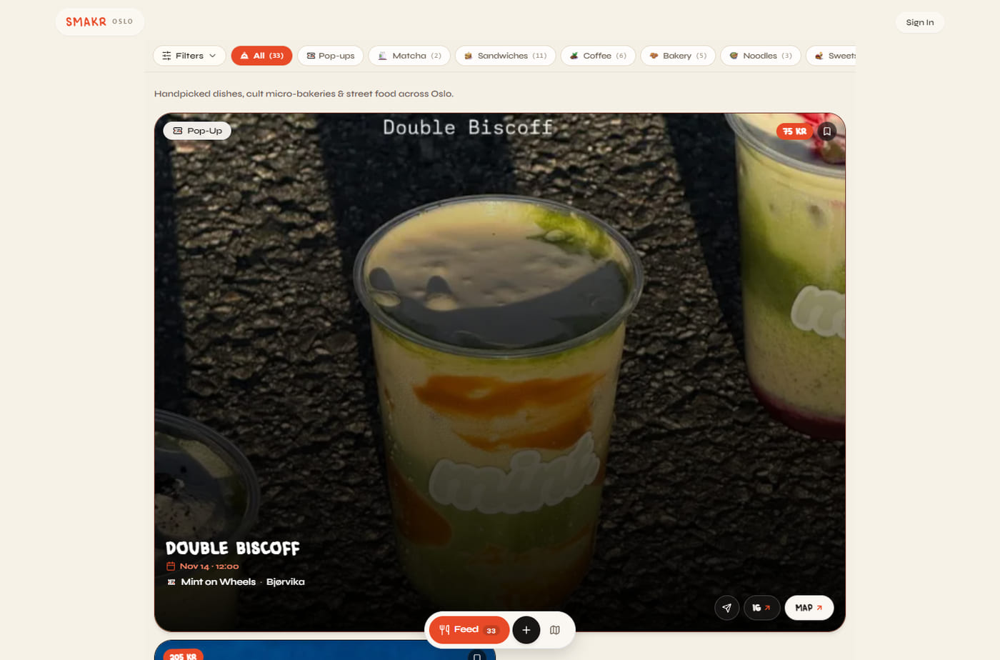

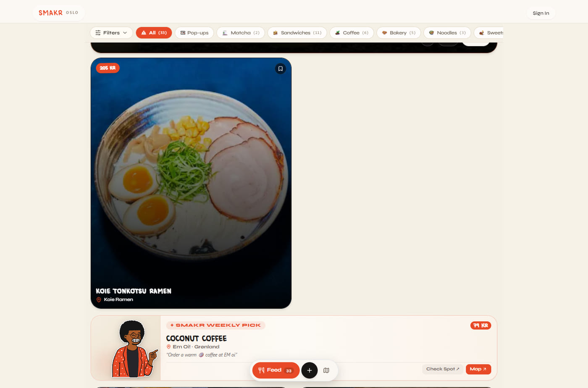

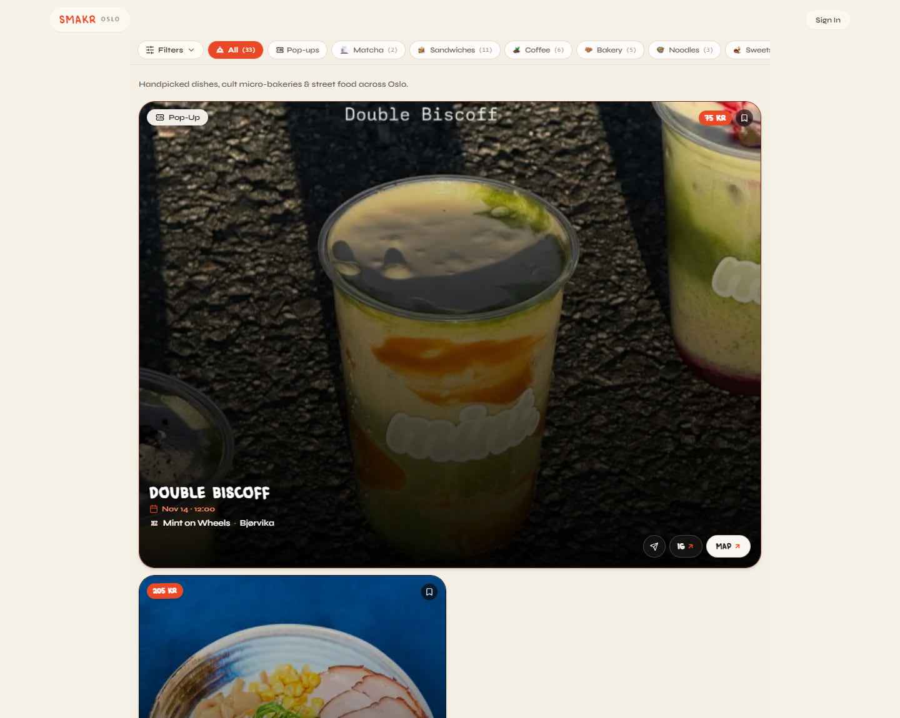

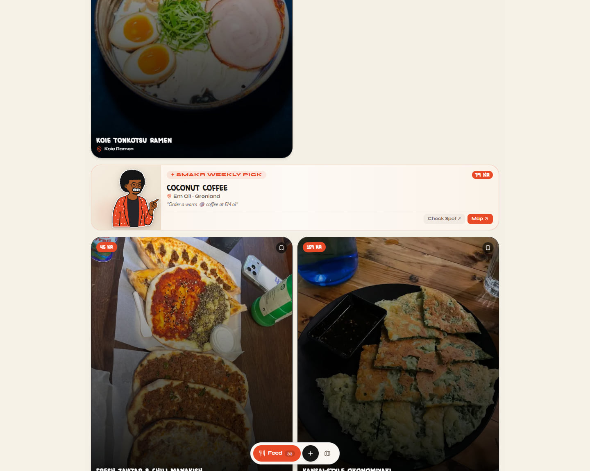

**What works:** the hero card is confident, the warm paper background is distinctive, and the type pairing (Comico + Jakarta) is on-brand.

**Problems:**

1. **Holes in the grid.** `renderCard` sets `col-span-full` for pop-ups (`HomeView.tsx:538`) while the container is `grid-cols-2` (`:504`). When the first item is a pop-up and the second is a normal dish, the second card occupies one cell and the other cell stays empty. The tall screenshot shows a 500px-wide card with a 500px-wide hole next to it, directly under the hero. This is the single strongest "incomplete" signal in the feed.
2. **Full-width items break lane rhythm.** The same thing happens whenever a pop-up or the weekly pick appears mid-sequence. The page alternates between 1-up and 2-up without a deliberate editorial reason.
3. **Duplicate content across lanes.** The hero pop-up (Double Biscott / Mint on Wheels) also appears in the matcha swimlane and the pop-up radar lane. The matcha lane is selected by text matching (`HomeView.tsx:435–449`), not by a curated lane membership, so it can include coffee/tea/pop-up posts that are already in the main sequence.
4. **The weekly pick banner is too empty at 1000px.** It is a single row with a 75px mascot on the left, a short text block, and two buttons on the far right. At desktop width the middle is ~60% blank. It reads as a placeholder.
5. **The floating slider covers the last visible card.** There is `pb-28`/`pb-36` on the scroller, but the slider is `absolute bottom-4` inside the feed panel and sits above the content at any scroll position. In `03` it covers the weekly pick's "$91 KR" pill and the "Check Spot" button.
6. **The feed intro is repeated on every visit.** "Handpicked dishes, cult micro-bakeries & street food across Oslo." occupies its own row and pushes the hero down. It is brand copy, not utility; it belongs in the header or an onboarding state, not above the content every time.
7. **Cards have inconsistent heights.** The hero is photo-led; the grid cards are portrait 4:5 with bottom-anchored text. The 2-up grid's row height is driven by the tallest card, so a long title or two-line meta can leave visible dead space in the sibling card.

**Recommendation:** replace the ad-hoc `col-span-full` logic with a **lane builder** that guarantees complete rows:

- Lane A: 1 full-bleed hero.
- Lane B: exactly 2 compact cards (never 1).
- Lane C: full-width weekly pick, but designed as a 2-column card with a food image on the right.
- Lane D: 2×2 grid.
- Swimlanes: curated, de-duplicated by `post.id` / `venue.id`.
- Remaining: 2-up rows; if odd, render the last card as a full-width horizontal card rather than leaving a hole.

#### Desktop filter drawer

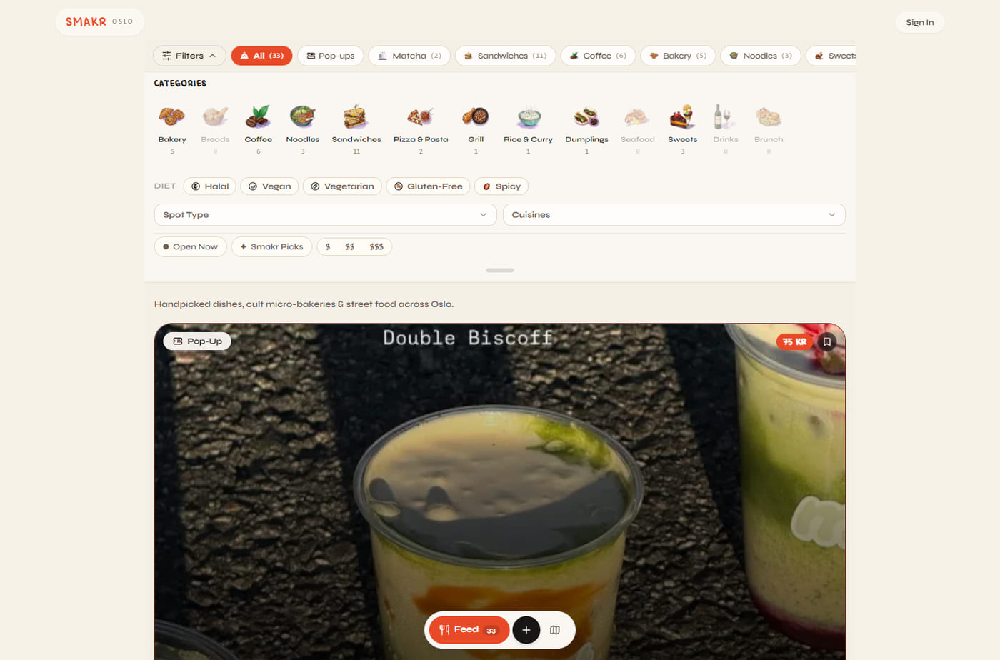

The drawer is constrained to the feed column (correct), but the same hierarchy problems as mobile apply: the category rail shows zero-count groups, the diet row is a form-like band, and the drawer's top edge is a hard border with no shadow or overlap treatment. The feed below is pushed down rather than dimmed, so the drawer and the feed compete for attention. A sticky drawer header with a result count and `Reset` would make the state much easier to read.

---

### 4.3 Mobile feed — strong start, then repetition and obstruction

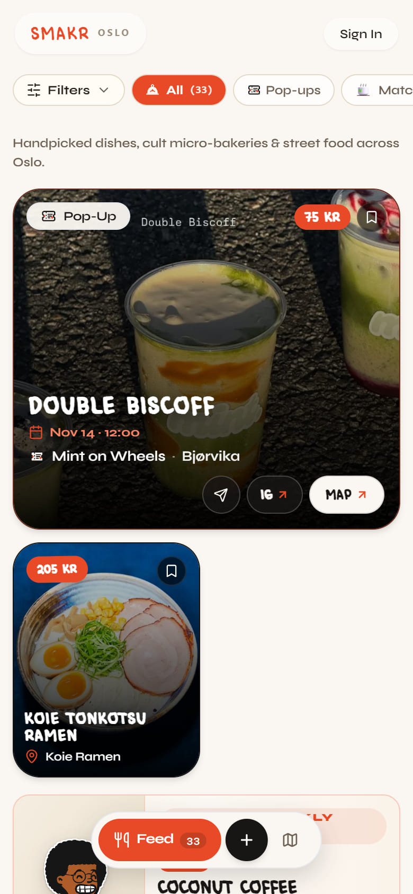

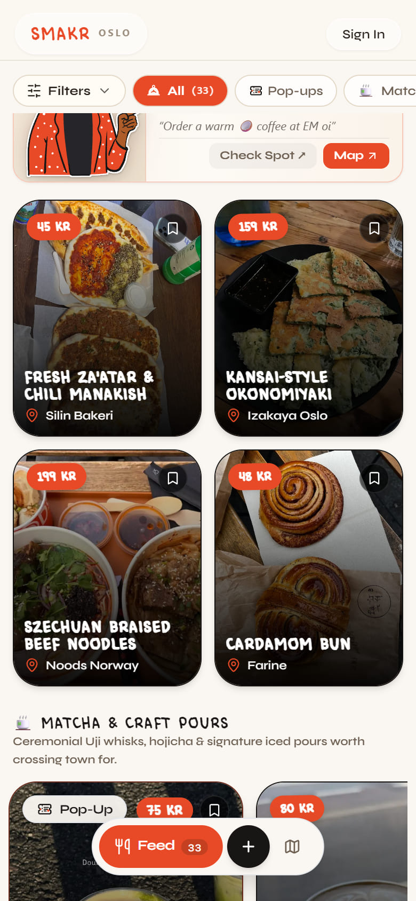

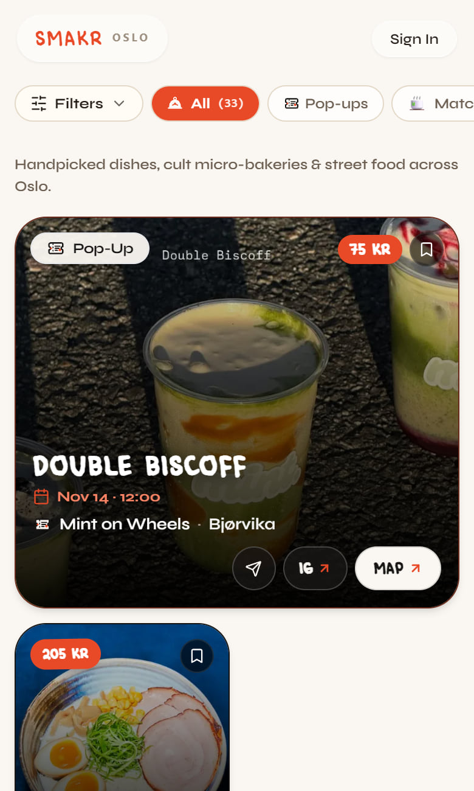

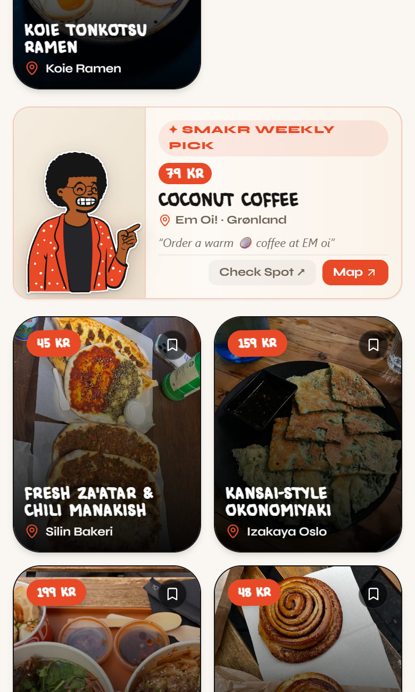

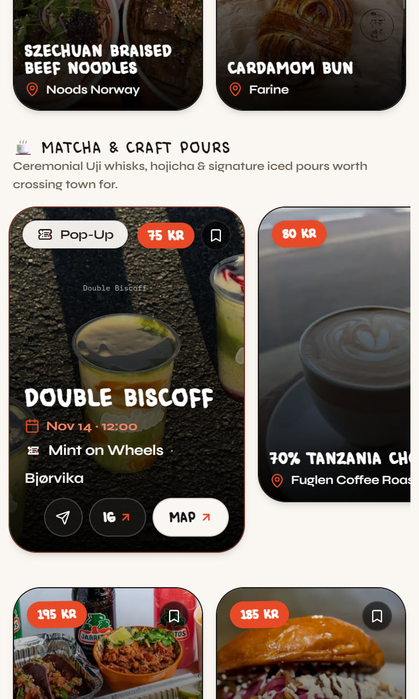

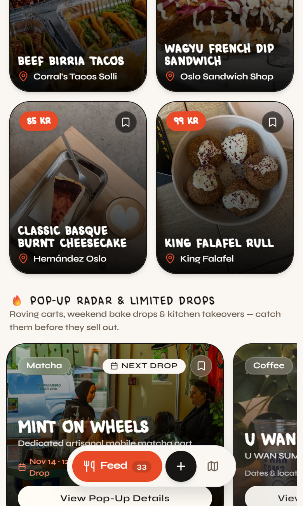

**What works:** the hero is genuinely good. It is edible, full-bleed, and the dark scrim keeps the title readable. The card ratio feels native.

**Problems:**

1. **The first grid row is a single card with a hole.** Same `col-span-full` cause as desktop. On a 390px screen the hole is especially obvious.
2. **The pop-up is repeated three times.** Hero "Double Biscott", matcha lane "Double Biscott", and pop-up radar "Mint on Wheels" are the same story. The feed feels padded rather than curated.
3. **Swimlane headings are too quiet.** "MATCHA & CRAFT POURS" is 14px Comico at the same visual weight as a card label. It does not read as an editorial section break. The explanatory line under it is 11px and low contrast.
4. **The matcha lane is a horizontal scroller with no scroll affordance.** The second card is cut at the viewport edge, which implies scrolling, but there is no fade, peek arrow, or page dots. On a phone this is ambiguous.
5. **The floating slider covers the pop-up radar.** In the tall screenshot it sits directly on top of the "MINT ON WHEELS" card and its "View Pop-Up Details" CTA.
6. **The filter drawer shows zero-count categories.** Breads (0), Seafood (0), Drinks (0), Brunch (0) are still rendered at 40% opacity (`FeedFilterBar.tsx:868–910`). They consume horizontal space and make the category rail feel noisy. The sub-category row correctly hides zeros (`:945`); the group row should do the same.
7. **The filter drawer has no result summary or reset affordance at the top.** "Filters" stays in the bar, but once the drawer is open there is no "12 dishes" or "Clear all" in view. The reset control is in the drawer header but not prominent.
8. **The floating slider is a three-button object with two unlabeled icons.** "Feed 33" is clear; "+" and the map icon are not. The plus opens create-bite; the map icon toggles to places. On a first visit this requires trial and error.

---

### 4.4 Mobile filter drawer

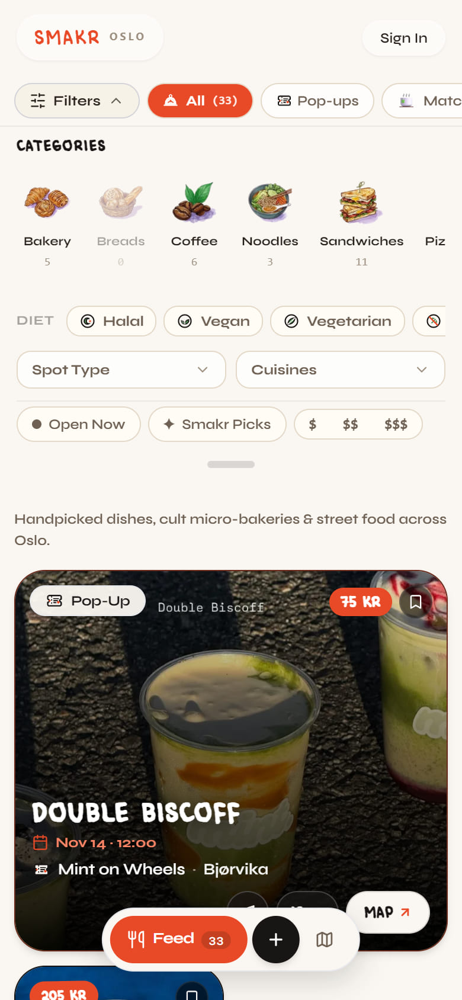

The drawer is functionally complete and the sectioning is logical (Categories → Diet → Spot Type / Cuisines → Open Now / Picks / Price). The issues are hierarchy, not capability:

- The category icons are 44px and the labels are 10.5px, so the icons dominate and the text is hard to scan.
- Counts are rendered as a third line under each label, aligned differently depending on label length. The row baseline wobbles.
- "DIET" is a grey uppercase label floating to the left of five chips; it reads like a form field, not an editorial filter.
- Zero-count groups are visible but disabled-looking (40% opacity). Either hide them or make them clearly selectable with a "no results" explanation.
- The drawer pushes the feed down but does not dim or lock it. With the floating slider still visible, the screen has two competing "active" zones.

**Recommendation:** use a segmented sheet with a sticky header (`Filters`, result count, `Reset`, `Done`), group categories into a 2-row grid with labels above counts, and hide empty groups behind a "More categories" disclosure.

---

### 4.5 Mobile map (resting)

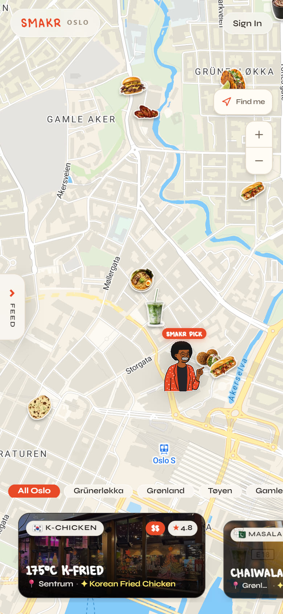

**What works:** the map is legible, the pins are charming, and the dock is a good idea. The warm beige map and the sticker pins belong together.

**Problems:**

1. **The Smakr mascot dominates the map.** The mascot is roughly 100×140px while venue pins are 30–40px. It is also not visually anchored to its venue pin: the "SMAKR PICK" badge sits above the head, and the actual dish icon floats beside the finger. At a glance it looks like a large sticker pasted on the map, not a recommendation marker.
2. **Only 8–10 pins are visible at the dock zoom.** That is fine for legibility, but there is no density signal: no cluster count, no "12 more spots" hint, no way to know the map is populated.
3. **The dock floats on bare map.** The neighbourhood pills are white/orange chips directly on the map with no tray, scrim, or gradient. The carousel cards below have their own shadows, but the whole bottom region lacks a container. It feels like UI dropped on top of a screenshot.
4. **The bottom carousel is cut by the viewport and by the next card.** That is expected for a carousel, but the first card is not left-aligned to the screen edge (px-6), and the next card is a narrow sliver. It is unclear whether the row scrolls.
5. **The FEED handle is tiny and cryptic.** A 9px vertical label in a 20px-wide tab. It is the only way back to the feed besides the browser back gesture.
6. **No attribution.** `attributionControl: false` (`MapRadarView.tsx:1256`) removes MapTiler/OSM credit. That is a legal/compliance issue, not just a design one.
7. **Controls are 36px.** `h-9`/`w-9` for Find me and zoom (`MapControls.tsx:71/88–100`) is below the 44px minimum touch target, and the zoom stack + Find me cover a large part of the top-right map.

---

### 4.6 The focused map card — detailed critique

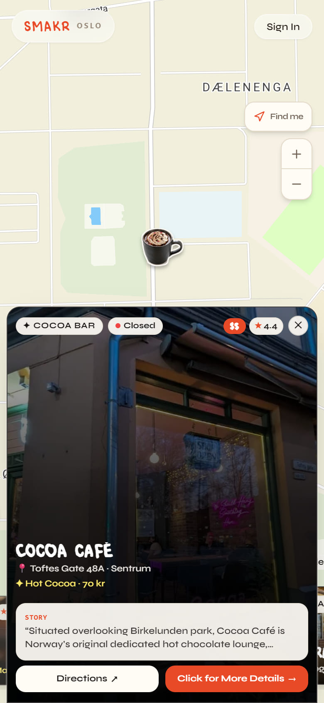

#### Current anatomy (measured at 390×844)

| Part | Measurement |
|---|---|
| Card | **374 × 476**, top **368**, bottom **844** (viewport bottom) |
| Opening | 260 × 118 at the carousel row (top 704) → expands to 374 × 476 |
| Top chip row | cuisine / open / price / rating / close, all 20–24px tall |
| Title block | name 20px, address 11px, signature 11px |
| Story panel | cream `#FAF7F2`, 9px label, 11.5px body, 2-line clamp |
| CTAs | 2 × 32px height, 11px labels |
| Close | 24 × 24px |
| Bottom offset | `translate-y-[22px]` → 22px below viewport |
| Pin gap | selected pin bottom y≈329; card top 368 → **39px** |

#### What works

- The card is anchored to the bottom, so it grows out of the tray rather than flying in from the side. The motion concept is correct.
- The warm-paper chips on the dark photo are a good contrast system and clearly Smakr.
- The pin-to-card gap of 39px is close to ideal; the pin remains visible.
- The start state (compact 260×118) preserves the carousel context.

#### What is wrong

1. **Dead middle.** The card is 476px tall. The top row is ~24px, the bottom block is ~150px (title + story + CTAs), and the photo occupies the remaining ~300px. Because the content is `justify-between`, there is no content in the middle: no dish photo strip, no quote, no facts, no map context. The eye reads "big photo, small footer".
2. **The photo is a background, not a subject.** It is the same cover image already shown in the carousel card and the venue sheet. The card does not add a new visual (dish close-up, interior, menu, price chip) to justify the size.
3. **The bottom is clipped.** `translate-y-[22px]` pushes the card below the viewport. The rounded bottom corners disappear, the safe-area padding is ineffective, and the CTA row sits flush against the screen edge. On a notched phone the home indicator will overlap the buttons.
4. **Touch targets are too small.** Close is 24px; Directions and "Click for More Details" are 32px tall. The recommended minimum is 44px.
5. **The primary CTA label is instructional, not appetising.** "Click for More Details" is 20 characters at 11px in a 2-column grid. It is also a second way to do what tapping the card already does, which creates ambiguity: what happens if I tap the card body?
6. **Missing actions.** No Save, Share, Check-in, "See dishes", opening hours, distance/walk time, or price-per-dish context. The venue sheet has "Log a Dish" and the full story; the map card has less than the card it came from.
7. **No dismissal affordance beyond the tiny ✕.** No drag handle, no swipe-down, no tap-outside hint. On mobile, a bottom sheet without a handle feels like a web modal.
8. **Visual language split.** The card is a dark photo with cream chips; the venue sheet is a cream surface with a photo header. The two representations of the same venue do not feel like the same product.
9. **Desktop duplication.** On desktop, selecting a pin opens the venue detail pane on the left *and* the sheet over the map. The sheet is a mobile pattern being used on a 1440px screen, and it covers the pane's story text. See `06`/`07`.

#### The layout bug behind the desktop overlap

The map container is:

```tsx
// HomeView.tsx:863–878
<div className="absolute inset-0 w-full h-full z-0 isolate
                lg:static lg:h-full lg:z-0 ... relative">
```

At `lg`, `lg:static` removes the positioning context. The dock is absolutely positioned inside it:

```tsx
// HomeView.tsx:901–910
<div className="absolute left-0 right-0 z-20 ... bottom-4">
  <MapNeighborhoodDock />
</div>
```

With no positioned ancestor inside the map pane, the dock resolves against the page root. Measured result:

| Element | x | width |
|---|---|---|
| Map canvas | 605 | **835** |
| Dock | 0 | **1440** |

So the card centres on the viewport (x=720), not the map (x=1022), and overflows 89px into the venue detail pane. This is why the card covers the story text in `07`.

**Fix:** keep the map container positioned (`relative` at all breakpoints, or wrap the dock in a `relative` div inside the map pane). If the intent is a full-width dock, move it outside the map container deliberately and give it its own background/scrim.

#### Proposed card anatomy

<div class="wireframe-row">
  <div class="wireframe">
    <div class="wireframe-label">Current — 476px</div>
    <div class="wf-card wf-current">
      <div class="wf-chiprow"><span></span><span></span><span></span><span></span></div>
      <div class="wf-empty">≈ 300px of photo<br/>with no content</div>
      <div class="wf-bottom">
        <div class="wf-title"></div>
        <div class="wf-line short"></div>
        <div class="wf-line shorter"></div>
        <div class="wf-actions"><i></i><i class="primary"></i></div>
      </div>
      <div class="wf-clip">22px clipped below viewport</div>
    </div>
  </div>
  <div class="wireframe">
    <div class="wireframe-label">Proposed — 400px</div>
    <div class="wf-card wf-proposed">
      <div class="wf-handle"></div>
      <div class="wf-hero"><span>cover · 2 dishes</span></div>
      <div class="wf-paper">
        <div class="wf-eyebrow">CUISINE · NEIGHBOURHOOD</div>
        <div class="wf-title big"></div>
        <div class="wf-meta">Open · $$ · ★ 4.7</div>
        <div class="wf-line"></div>
        <div class="wf-story">3-line story excerpt with “Read more”</div>
        <div class="wf-actions big"><i class="primary wide">See the spot</i><i class="icon">↗</i><i class="icon">♡</i><i class="icon">⇪</i></div>
      </div>
    </div>
  </div>
</div>

*Illustrative anatomy comparison, not to scale. The point is the distribution of content, not the exact pixels.*

The proposal is a **44–48dvh card** (≈370–405px at 844px), with a paper content surface and a shorter, purposeful image area:

| Zone | Height | Content |
|---|---|---|
| Handle | 20px | 36×4px grabber, centered; swipe-down to dismiss |
| Hero | ~38% (150px) | cover photo, bottom fade into paper; small "2 dishes" pill |
| Identity | 64px | eyebrow (cuisine · neighbourhood), H2 name 24px, meta row: open · price · ★ rating |
| Signature | 40px | `✦ Hot Cocoa · 70 kr` + "See 3 dishes" link |
| Story | 64px | 3-line excerpt with "Read more" inline; no boxed cream panel |
| Actions | 56px | primary `See the spot`; 44px icon buttons: Directions, Save, Share |
| Safe area | 16px | `env(safe-area-inset-bottom)` |

Behaviour:

- **Peek:** 260×118, name + rating + open + cuisine; tap to expand.
- **Open:** animate only `transform` and `opacity` (translateY from the peek row), never width/height.
- **Desktop:** do not show this sheet at all when the venue detail pane is open. Use a compact 360px card anchored to the map's bottom-right, or simply highlight the pin and let the left pane be the single source of truth.
- **Close:** ✕, swipe-down, tap-outside, and `Esc`. All targets ≥44px.

---

### 4.7 Desktop map and focused card

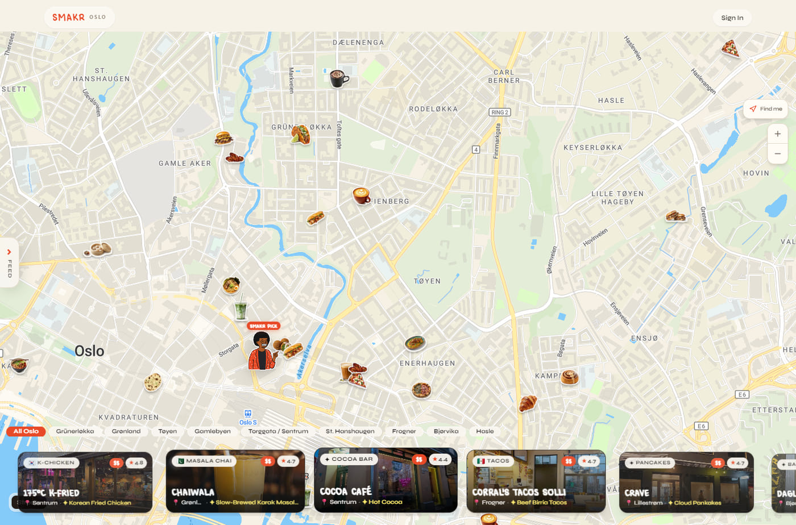

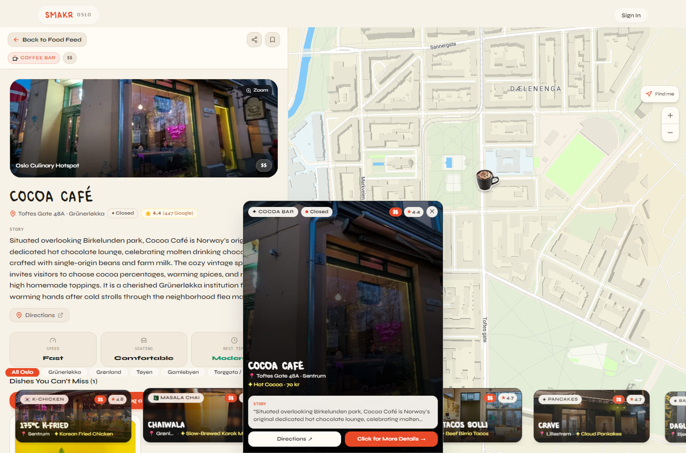

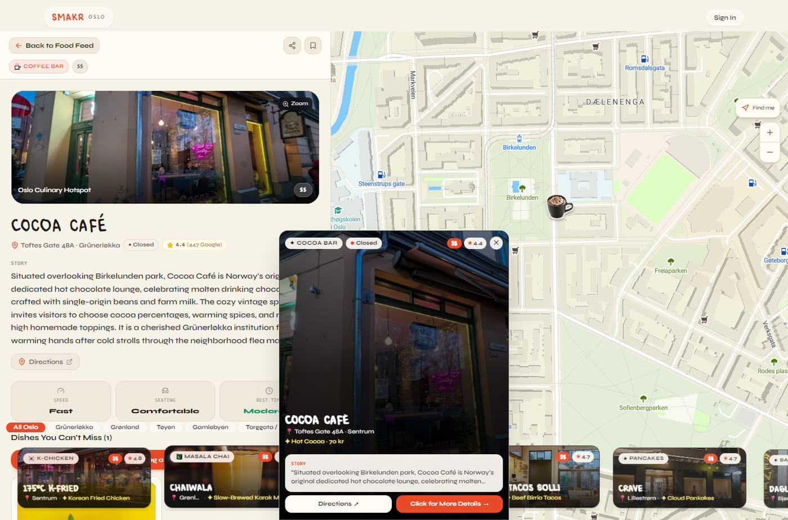

**Problems specific to desktop:**

1. **The dock is a mobile pattern stretched to 1440px.** Neighbourhood pills and 260px cards at the bottom of a 1440px map look like a phone UI pasted onto a desktop canvas. On desktop, a horizontal deck of 5 cards is fine, but the pills should be a compact segmented control, and the deck should be constrained to the map pane (max-width ~900px) rather than the full viewport.
2. **Selecting a venue opens two representations at once.** The left pane renders the full venue (photo, story, speed/seating cards, dishes), while the sheet renders a reduced version over the map. The user cannot tell which one is primary.
3. **The sheet covers the left pane.** Because of the dock containment bug, the 420px card extends from x=514 to x=926, crossing the pane boundary at x=603. It covers the story text and the "Dishes You Can't Miss" heading.
4. **The sheet is still bottom-clipped.** The CTAs are at y≈918 in a 950px viewport, 32px above the bottom but with the card extending 22px below it.
5. **The map's selected pin is not obvious.** `applyPinState` defines `#smakr-diecut-selected` but both branches set `filter: url(#smakr-diecut-default)` (`MapRadarView.tsx:152/166`). The selected state is only a 1.15–1.22 scale change, which is hard to see against the sticker pins.
6. **The zoom-out on empty-map click fights the card close.** `MapRadarView.tsx:1389–1405` still calls `easeTo({ zoom: min(zoom, 14.2), duration: 500 })` after a deselect. Closing with ✕ does not, but closing by tapping the map does. Two different closing motions for the same action.

**Recommendation:** on desktop, make the left detail pane the single venue surface. Selecting a pin should scroll/refresh that pane and highlight the pin; the sheet should be mobile/tablet only. If a map-anchored card is required, anchor it to the map pane and cap it at 360px.

---

### 4.8 Mobile venue detail (the quality bar)

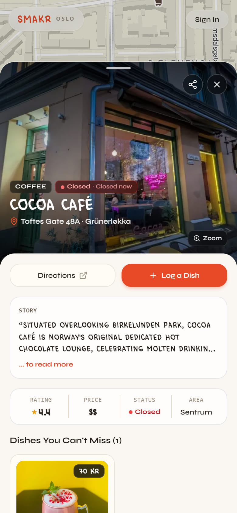

This surface is the strongest in the build and should be the reference for the map card:

- Clear photo header with title overlay.
- A single paper surface with rounded top corners.
- Two prominent actions (Directions / Log a Dish) at 44px+.
- A story panel with an explicit "to read more" affordance.
- A 4-cell facts row (Rating / Price / Status / Area).
- A dish section with a real price chip.

The map card should borrow this hierarchy instead of inventing a second, thinner one.

Minor issues: "Closed · Closed now" is duplicated; "COFFEE" and "Closed" pills sit on the photo with low contrast in bright areas; the story text is all-caps because of the font, which hurts long-form reading.

---

## 5. Performance audit

### 5.1 Measured results

| Scenario | Frames | p50 | p95 | Max | Frames >34ms |
|---|---:|---:|---:|---:|---:|
| Map idle | 60 | **17ms** | 18ms | 19ms | 0 |
| Map pan (900ms) | 60 | 18ms | **111ms** | 258ms | **23 / 60** |
| Map zoom-in (+0.5, 900ms) | 60 | **84ms** | 112ms | 180ms | **54 / 60** |
| Map zoom-out (−0.5) | 60 | 17ms | 120ms | 127ms | 17 / 60 |
| Zoom-in, SVG filter removed | 60 | **30ms** | 124ms | 129ms | 29 / 60 |
| Zoom-in, all pins hidden | 60 | **18ms** | 132ms | 324ms | 26 / 60 |
| Feed idle | 60 | 16ms | 138ms | 264ms | 3 / 60 |
| Feed after scroll | 60 | 17ms | 60ms | 211ms | 4 / 60 |

**Reading the table:**

- The idle map is smooth (~59fps). The problem appears only when the camera moves.
- **Zoom is the worst case:** p50 84ms ≈ **12fps**. Panning is better (p50 18ms) but still has a 111ms p95.
- Removing the pin SVG filter nearly triples zoom performance (84ms → 30ms p50).
- Hiding pins entirely gets to the idle baseline (18ms).
- Zoom-out is smooth because the pins shrink and fewer new tiles are decoded. Zoom-in enlarges each filtered pin and loads new tiles, so the filter raster area grows at the same time.

### 5.2 Root cause P1 — SVG filters on every marker

Each of the 32 venue pins applies a CSS `filter` that references an SVG filter chain:

```tsx
// MapRadarView.tsx:433–446
<div class="smakr-puck-icon" style="
  filter: url(#smakr-diecut-default);
  transition: filter 0.2s ease, width 0.15s ease, height 0.15s ease;
">
```

The filter is not a simple drop shadow. It runs:

1. `feMorphology` dilate (alpha),
2. `feFlood` + `feComposite`,
3. `feDropShadow`,
4. `feMerge`.

That is a multi-pass raster operation for every pin, on every frame the pin's size or position changes. During a zoom, MapLibre repositions every marker and `applyPinState`/the zoom loop changes `.pin-visual` scale, so the filter is re-rasterised continuously. On SwiftShader this is catastrophic; on a mid-range phone it is still expensive, especially at DPR 3.

The code even defines a `#smakr-diecut-selected` filter (orange rim + glow) but never applies it: both selected and unselected branches set `#smakr-diecut-default` (`MapRadarView.tsx:152/166`). The fanciest filter is dead code; the expensive one is used 32×.

**Fixes, in order of impact:**

1. **Bake the die-cut outline into the pin assets.** Each dish WebP already has a transparent background; add the cream outline + shadow in the asset pipeline (or in the SVG source). Zero runtime filter.
2. If runtime outline is required, replace `feMorphology` with a cheap CSS `drop-shadow()` chain on the WebP (still not free, but far cheaper than morphology).
3. Move all non-selected pins to a **MapLibre symbol layer** with an SDF icon; keep DOM markers only for the selected pin and the mascot. This removes 31 DOM elements from the per-frame camera path.
4. Remove `transition: filter` from `.smakr-puck-icon`; never animate a filter.

**Acceptance:** zoom-in p50 ≤ 20ms in the same headless harness (currently 84ms), and no visible pin lag during a 1s pinch.

### 5.3 Root cause P2 — the weekly mascot is rebuilt every zoom frame

```tsx
// MapRadarView.tsx:1333–1370
map.on("zoom", () => {
  ...
  markerPoolRef.current.forEach((entry) => {
    const visual = entry.rootEl.querySelector<HTMLElement>(".pin-visual");
    if (visual) visual.style.transform = ...;   // 32 querySelector + style writes
  });
  ...
  renderWeeklyMarker();                          // every zoom event
});
```

And `renderWeeklyMarker` rebuilds the DOM:

```tsx
// MapRadarView.tsx:1187–1237
weeklyMarkerRef.current.setLngLat([lng, lat]);
const root = weeklyMarkerRef.current.getElement();
...
root.innerHTML = "";                 // destroy badge + image + listener
const inner = document.createElement("div");
...
const badge = buildWeeklyBadge();
const bustContainer = document.createElement("div");
bustContainer.innerHTML = ``;
inner.appendChild(bustContainer);
inner.addEventListener("click", ...);
root.appendChild(inner);
```

MapLibre fires `zoom` on every animation frame during a fly/pinch. So a 380ms card fly rebuilds the mascot ~20–25 times, including parsing HTML, creating an ``, and attaching a listener. Measured: **27 child mutations** and **205 marker style mutations** in a single 800ms `flyTo`.

**Fix:** create the mascot once. On zoom, only update:
- its projected position (MapLibre does this),
- `inner.style.transform = scale(...)` or a CSS variable,
- the badge text if the pick changes.

Remove `renderWeeklyMarker()` from the `zoom` handler and call a lightweight `updateWeeklyScale()` instead. Rebuild only when `weeklyPick.venue_id` changes.

**Acceptance:** zero `childList` mutations under `.weekly-pick-marker-root` during a 1s zoom.

### 5.4 Root cause P3 — CSS transitions retriggered by JS every frame

Two places write a transform every frame while a CSS transition is declared on the same property:

```tsx
// MapRadarView.tsx:363–374
inner.style.transition = "transform 0.22s cubic-bezier(0.34, 1.56, 0.64, 1)";
// ...
if (visual) visual.style.transform = isSelected ? selectedScale : `scale(${baseScale})`;
```

```tsx
// MapNeighborhoodDock.tsx:104–107
style={{
  transition: "transform 180ms cubic-bezier(0.22,1,0.36,1), opacity 180ms ease-out",
}}
// ... updateCarouselParallax writes el.style.transform and el.style.opacity every scroll frame
```

When JS changes the property, the transition restarts from the current computed value. If the property changes every 16ms and the transition lasts 180–220ms, the element is **permanently chasing** the target. Visually this is the "rubbery" lag the user is feeling: pins trail the map, carousel cards trail the scroll, and the scroll-snap fights the transform.

**Fixes:**

- Remove the transition from `.pin-visual` and the carousel card while the camera/scroll is driving them. Apply a transition only for discrete state changes (selection), e.g. add a `.is-settling` class after `zoomend`.
- For the carousel, use a **scroll-driven CSS animation** (`animation-timeline: view()` where supported) or compute the transform in `requestAnimationFrame` with **no** transition. Keep `will-change` off the 32 cards; promote only the visible 3.
- Do not animate `opacity` per card every frame; fade the edges with a mask on the container instead.

**Acceptance:** a pin's `getBoundingClientRect()` matches the map's projected point within 1px during a pan, and the carousel card's transform changes monotonically with `scrollLeft` (no overshoot).

### 5.5 Root cause P4 — the card animates layout properties

```tsx
// MapNeighborhoodDock.tsx:707–715
style={{
  transition:
    "transform 280ms cubic-bezier(0.16,1,0.3,1), width 280ms ..., height 280ms ...",
}}
className={`... ${
  sheetExpanded
    ? "w-[calc(100vw-16px)] max-w-[420px] h-[calc(50dvh+54px)] ... translate-y-[22px] ..."
    : "w-[260px] h-[118px] translate-y-0 ..."
}`}
```

Animating `width` and `height` forces the browser to recalculate layout on every frame, then repaint the card's full surface (photo, gradient, text, chips). That happens concurrently with the MapLibre fly (tile decode, marker writes), which is exactly when the main thread is busiest.

The open path also has a multi-step latency chain:

1. `setSelectedVenue()` → React render.
2. `useEffect([selectedVenue?.id])` runs after paint → `setDisplaySpotlight()`.
3. The card is gated on `displaySpotlight` (`MapNeighborhoodDock.tsx:701`), so it mounts one render later.
4. `requestAnimationFrame(tryOpen)` waits for the next frame, forces reflow, then `setSpotlightOpen(true)`.
5. Only then does the 280ms width/height transition start.

Measured in the store-only test (no map fly): card mounts at **78ms**, but the expansion does not start until **~340ms**, and reaches full 476px at **~556ms**. On a real device the absolute numbers are smaller, but the architecture adds at least two frames of delay and a layout-bound animation.

**Fixes:**

1. **Render the card in the same commit as selection.** Gate the overlay on `activeSpotlight` (which already includes `selectedVenue`), not `displaySpotlight`. Keep `displaySpotlight` only for holding the last card during close.
2. **Animate transform only.** Give the card its final size in layout and start it at `translateY(calc(100% - 118px))`; animate to `translateY(0)`. The peek state and the open state then share one DOM size.
3. Alternatively, use a **FLIP shared-element** transition: measure the tapped card, apply a `translate/scale` transform from that rect to the sheet rect, and animate `transform` + a crossfade. This also delivers the "grows out of the tapped card" intent better than width/height.
4. Add `contain: layout paint` and `content-visibility: auto` to the sheet content during the animation.

**Acceptance:** expansion starts within one frame of the click, animates only `transform`/`opacity`, and the first frame is never a compact card that then jumps.

**The same layout-animation problem exists on the map pane.** `HomeView.tsx:876` uses `transition-all duration-350` while the width class changes between `lg:w-0` (feed), `lg:w-[54%]` (split/venue open) and `lg:w-full` (map). Animating the width of the MapLibre container forces the `ResizeObserver` to call `map.resize()` and repaint the WebGL canvas on every frame. On desktop, switching views or opening a venue therefore resizes the map 20+ times in 350ms while the feed and card are also animating. Replace this with a snap or a `transform`/`opacity` crossfade; never animate the map container's width.

### 5.6 Root cause P5 — the feed's DOM and image budget

Measured on `/?view=feed` at 390×844:

| Metric | Value |
|---|---:|
| DOM nodes | **3,894** |
| `` elements | **229** |
| Feed scroll height | **13,167px** |
| Grid containers | 3 |
| Persistent overlays | 1 slider (+ header) |

229 images for a 33-card feed is high. The feed uses `next/image` in places and raw `` in others (flags, swimlane icons, map pins, avatars). Many are below the fold and should be lazy; many are tiny but still decode.

The feed grid also renders all cards at once (`remainingDishes.map`), with no virtualisation. 3,894 nodes is manageable on desktop but expensive on a low-end phone, especially while the map is alive in the DOM (split mode) and MapLibre is still decoding tiles.

**Fixes:**

- Add `sizes` and `loading="lazy"` to every non-hero image; use `decoding="async"`.
- Replace flagcdn `` chips with a CSS sprite or emoji-free inline SVG; 33 network requests for 14×10px flags is wasteful.
- Virtualise below-the-fold cards (or use `content-visibility: auto` on card wrappers with `contain-intrinsic-size`).
- Pause MapLibre rendering when `viewMode === "feed"`: the map is `lg:w-0 lg:opacity-0` but still mounted. Use `map.stop()` and a `display:none`/`visibility` gate, or unmount the canvas after a delay.

**Acceptance:** feed DOM ≤ 2,500 nodes, images in the initial viewport ≤ 20, and no map render work while the feed is full-screen.

### 5.7 Why the map "feels laggy" even though idle FPS is fine

A user perceives lag in three moments:

1. **Pinch/zoom.** The camera moves smoothly, but the pins trail and stutter. That is P1 (filters) + P3 (transitions) + P2 (mascot rebuild). The map canvas may be at 60fps; the DOM layer is not.
2. **Tap a pin.** The card should appear instantly. Instead, the network was removed but the card still waits for an effect, a rAF, a forced reflow, and a 280ms width/height animation. Meanwhile the map fly starts after 40ms and competes for the same main thread. That is P4.
3. **Pan across the city.** The map is mostly smooth but spikes to 100ms+ when pins enter the viewport or the mascot is rebuilt. That is P1/P2 again.

The tile provider is not the primary problem. The style is vector, the map is cached after first load, and hiding the pins restores the idle frame budget. The decoration layer is the cost.

### 5.8 What did **not** show up as a problem

- **Initial load**: TTFB 150ms, FCP 464ms, DCL 484ms. Fine.
- **Bundle size**: 446 kB first-load JS is acceptable for a map + feed app; the route chunk is 51.5 kB.
- **Map idle**: 17ms p50. The map engine itself idles well.
- **React re-render of the feed on pin selection**: the memoized feed trees (`HomeView.tsx:671–677`) and the map-mode selector (`MapRadarView.tsx:552–554`) do prevent the big re-render. Keep these.

---

## 6. Prioritised change plan

### P0 — do these first (map smoothness + card correctness)

| # | Change | Files | Why | Effort |
|---|---|---|---|---|
| 1 | Remove `filter: url(#smakr-diecut-default)` from pins; bake the outline into assets, or use a cheap `drop-shadow` chain | `MapRadarView.tsx:285–480`, `MapPinDefs` | Zoom p50 84 → 30ms with filters off; 18ms with pins hidden | M |
| 2 | Create the weekly mascot once; on zoom only update scale/position | `MapRadarView.tsx:1051–1239`, `1333–1370` | Eliminates 20–25 DOM rebuilds per fly | S |
| 3 | Remove per-frame CSS transitions from `.pin-visual` and carousel cards | `MapRadarView.tsx:374`, `MapNeighborhoodDock.tsx:104` | Stops the trailing/rubbery motion | S |
| 4 | Animate the card with transform only; render it in the same commit as selection | `MapNeighborhoodDock.tsx:377–412`, `701–715` | Removes layout animation and ~300ms start latency | M |
| 5 | Keep the dock inside the map pane on desktop (`lg:relative`, or a positioned wrapper) | `HomeView.tsx:863–910` | Fixes the card covering the venue pane | S |
| 6 | Hide zero-count filter groups and remove the dead `#smakr-diecut-selected` filter or apply it | `FeedFilterBar.tsx:868–910`, `MapRadarView.tsx:152/166` | Noise + dead code | S |

**Also P0:** stop animating the map pane width (`HomeView.tsx:876`, `transition-all` + width classes). Snap the width or crossfade; every animated width frame triggers a MapLibre resize and repaint.

### P1 — design completeness

| # | Change | Files | Why | Effort |
|---|---|---|---|---|
| 7 | Replace `col-span-full` ad-hoc layout with a lane builder that guarantees complete rows | `HomeView.tsx:489–655` | Removes the biggest "incomplete" signal | M |
| 8 | De-duplicate posts across hero, matcha, pop-up and kitchen lanes | `HomeView.tsx:428–449`, `571–618` | Stops the same story appearing 3× | S |
| 9 | Redesign the map card to the 44–48dvh anatomy: handle, paper surface, 3-line story, primary CTA + icon actions, 44px targets | `MapNeighborhoodDock.tsx:698–855` | Makes the card feel finished | L |
| 10 | On desktop, use the venue pane as the single source; show no sheet or a 360px map-anchored card | `HomeView.tsx`, `MapNeighborhoodDock.tsx` | Removes duplicate representation | M |
| 11 | Reserve space for the floating Feed slider (padding + gradient scrim) or move it into the header | `HomeView.tsx:845–850/1022–1038` | It currently covers content | S |
| 12 | Add attribution back to the map | `MapRadarView.tsx:1256` | Legal/compliance | S |
| 13 | Increase map controls to 44px and group them | `MapControls.tsx:71/88–100` | Touch accessibility | S |

### P2 — polish and scale

| # | Change | Files | Why | Effort |
|---|---|---|---|---|
| 14 | Lazy-load/size every non-hero image; replace flag `` with a sprite | `FoodPostCard.tsx`, `PopupEventCard.tsx`, dock | 229 images is too many | M |
| 15 | Pause/unmount MapLibre work when the feed is full-screen | `HomeView.tsx:863–878` | Frees GPU/CPU for the feed | S |
| 16 | Strengthen the selected-pin treatment (orange rim, scale, z-index, optional halo) | `MapRadarView.tsx:125–179` | Selection is hard to see | S |
| 17 | Shrink or hide the mascot at city zoom; anchor it to its venue pin | `MapRadarView.tsx:1051–1239` | It dominates the map | M |
| 18 | Add an "empty map" state with nearby counts and a reset | `MapRadarView.tsx`, `MapNeighborhoodDock.tsx` | The map can look empty | S |
| 19 | Add INP/LoAF instrumentation in production to validate on real devices | new hook | The headless numbers are upper bounds | S |

### Suggested sequence

1. **Day 1:** P0 #1–#4. Re-measure zoom and open/close. Expect the biggest perceived improvement.
2. **Day 2:** P0 #5–#6, P1 #7–#8. Fix layout containment and feed holes.
3. **Day 3–4:** P1 #9–#10. Redesign the card and desktop behaviour.
4. **Day 5:** P1 #11–#13, P2 #14–#19.

### Acceptance criteria

- Zoom-in p50 ≤ 20ms in the same headless harness; no frame >34ms during a 1s pinch on a mid-range Android (device test).
- Card expansion starts within one frame of the tap; only `transform`/`opacity` animate; no width/height transition in DevTools.
- No `childList` mutations under `.weekly-pick-marker-root` during a zoom.
- The dock's bounding box equals the map pane's bounding box at 1440px.
- No single card row with an empty sibling cell in default feed mode.
- All interactive targets ≥44×44px.
- Map attribution visible.

---

## 7. Appendix

### A. Key files

| File | Role |
|---|---|
| `frontend/src/components/home/HomeView.tsx` | Feed layout, swimlanes, map pane, dock placement, filters |
| `frontend/src/components/map/MapNeighborhoodDock.tsx` | Bottom dock, neighbourhood pills, carousel, focused sheet |
| `frontend/src/components/map/MapRadarView.tsx` | MapLibre instance, pins, weekly mascot, camera, selection |
| `frontend/src/components/filter/FeedFilterBar.tsx` | Filter strip and drawer |
| `frontend/src/components/map/MapControls.tsx` | Find me + zoom controls |
| `frontend/src/components/ui/Header.tsx` | Logo, account, scroll backdrop |
| `frontend/src/components/venue/VenueBottomSheet.tsx` | Full venue detail sheet |
| `frontend/src/store/useCityPulseStore.ts` | `viewMode`, `selectedVenue`, `feedLayout`, filters |

### B. Measurement harness (reproducible)

The harnesses used for this audit are in `C:\Users\abdis\AppData\Local\Temp\opencode\`:

- `capture-audit.cjs` — desktop/mobile screenshots
- `capture-tall.cjs` — full-height feed captures
- `probe-audit.cjs` — geometry, marker mutations, feed counts
- `probe-anim.cjs` — card open/close timing
- `probe-frames.cjs` — feed/map frame cadence
- `probe-attribution.cjs` — filter/pin/weekly attribution

Run with the production server at `http://localhost:3010` (`AUDIT_BASE` overrides).

### C. Screenshot index

| File | Description |
|---|---|
| `01-desktop-split.png` | Desktop split, 1440×950 |
| `02-desktop-feed-top.png` | Full feed top |
| `03-desktop-feed-scrolled.png` | Full feed at scroll 780 |
| `05-desktop-map.png` | Map mode resting |
| `06-desktop-map-card.png` | Focused map card |
| `07-desktop-venue-detail.png` | Venue detail + map card overlap |
| `08-desktop-filters.png` | Filter drawer |
| `09-mobile-feed-top.png` | Mobile feed top |
| `11-mobile-feed-scrolled.png` | Mobile feed scrolled |
| `12-mobile-filters.png` | Mobile filter drawer |
| `13-mobile-map.png` | Mobile map resting |
| `14-mobile-map-card.png` | Mobile focused card |
| `15-mobile-venue-detail.png` | Mobile venue detail |
| `16-desktop-feed-tall.png` | Feed rhythm, 1440×2300 |
| `17-mobile-feed-tall.png` | Feed rhythm, 390×2600 |

### D. Limitations

- Headless Chromium uses SwiftShader; absolute FPS is not representative of a real GPU. The **relative** attribution and the code causes are the durable findings.
- The map data and feed content are the live demo dataset; specific venues shown are illustrative.
- No real-device INP trace was captured. The production instrumentation recommendation (P2 #19) closes that gap.
- The audit focused on `feedMode = food`, `feedLayout = grid`, and map mode. The `places` feed and list layout were not reviewed in depth.

---

*End of audit.*
