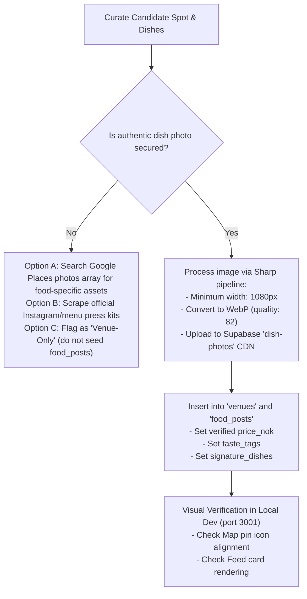

# Seeding & Feed Image Forensic Audit

**Document Purpose**: Root-cause analysis of the reverted seeding attempt and architectural blueprint for future Oslo food discovery curation.  
**Audience**: Remote Curation Agent, Ingestion Scripts, and Core Team.  
**Date**: November 2026  
**Status**: Active Research Directive  

---

## 1. Executive Summary

During the initial batch seeding attempt, several new Oslo venues and signature dishes were imported into the database (`venues` and `food_posts`). While the venue metadata and coordinate mapping functioned properly, **the feed experience suffered a critical breakdown in visual curation**:
1. Every dish card in the feed displayed photos of **restaurant facades, storefronts, or empty indoor seating** rather than the actual dishes.
2. Dishes lacking a photo fell back to **32px transparent map icon stickers** (`/icons/food/*.webp`), which appeared blown-up and broken on full-bleed mobile feed cards.
3. The dataset was reverted because **Smakr is a dish-first culinary radar, not a generic business directory**. Showing building exteriors in a food discovery feed destroys user trust and product immersion.

---

## 2. Root-Cause Analysis

### 2.1 The Feed Architecture & Data Flow
Smakr has two distinct visual discovery surfaces:
* **Venue Cards (`FoodSpotCard`)**: Represents the place. Uses `venues.cover_image_url` or `primaryDishPhoto`.
* **Dish Feed (`FoodPostCard`)**: The core discovery feed. Displays `food_posts.dish_image` in an edge-to-edge, full-bleed hero container.

```
┌────────────────────────────────────────────────────────┐
│                   SMAKR APP FEED                       │
├────────────────────────────────────────────────────────┤
│  [ FoodPostCard: Dish Hero Photo ]                     │
│  - MUST be high-res macro/table food photo             │
│  - OVERLAID with: Dish Name, Price (NOK), Venue Name   │
│  ❌ NEVER show restaurant street facade or parking lot │
│  ❌ NEVER show blurry 32px map icons or placeholders   │
└────────────────────────────────────────────────────────┘
```

### 2.2 Why the Automated Script Failed
In `frontend/scripts/seed_candidates.mjs`, photo resolution was implemented as:
```javascript
// Google Places Text Search returns 'photos'
const photoRef = place.photos[0].name; // <--- The culprit!
```
1. **Google Places Indexing Bias**: Google's top photo (`photos[0]`) for nearly all Oslo establishments is an **exterior street view** taken by a pedestrian, an entrance sign, or a wide shot of tables.
2. **Cascading Photo Duplication**: When inserting `dish_highlights` into `food_posts`, the script assigned:
   ```javascript
   const dishImage = venueData?.image_url || `/icons/food/${spot.icon}.webp`;
   ```
   Every dish for a venue was assigned the same storefront photo or the fallback map icon.

---

## 3. Core Curation Invariants

To prevent this from recurring, all human and automated agents must adhere to the following **Strict Curation Invariants**:

### Invariant 1: No Food Post Without a Verified Dish Photo
* If you find a fantastic Oslo bakery, taqueria, or ramen bar, but **do not have a verified, close-up photograph of their dish**, you may insert the venue into `venues` (if a facade photo exists), but **DO NOT create a `food_post` for the feed**.
* The feed must remain 100% appetizing, high-craft, and authentic.

### Invariant 2: Zero Placeholders on Feed Cards
* The feed card must **never** receive `/icons/food/*.webp` or generic SVG placeholders as its `dish_image`.
* If a dish post has no image, it must not be published (`is_published: false`).

### Invariant 3: Separation of Storefront vs. Dish Assets
* `venues.cover_image_url`: Can be a beautiful interior, open kitchen, counter, or storefront.
* `food_posts.dish_image`: Must **strictly** be a photo of the food itself (plated dish, cross-section of pastry, pour-over, noodle bowl).

---

## 4. Technical Protocol for Future Ingestion

When the curation workflow resumes, automated ingestion must follow a multi-step verification pipeline:



### 4.1 Google Places Photo Filtering Strategy
Instead of blindly selecting `places.photos[0]`, the ingestion script must:
1. Fetch the full `places.photos` array (up to 10 photos).
2. Use Google Places Photo metadata or a lightweight vision classifier to select photos tagged with `dish` or `food`.
3. If no photo is clearly identifiable as food, skip dish-post creation and log the spot for manual photo sourcing.

### 4.2 Ingest-Once Storage Pipeline
All external photos must be ingested into Supabase Storage CDN:
* Bucket: `dish-photos`
* Format: Sharp `.webp` (q=82, max width 1080px).
* Never hotlink Google Places URLs directly (violates Google Terms and incurs high per-session latency).

---

## 5. Summary Checklist Before Any Future Database Seeding

- [ ] Every candidate spot has been vetted against `curation/CURATION_BRIEF.md` (no generic chains or tourist traps).
- [ ] Every seeded dish in `food_posts` has a unique, appetizing, macro food photo.
- [ ] No storefronts or interior seating photos appear as dish thumbnails.
- [ ] Zero fallback icons or placeholder graphics exist in `food_posts`.
- [ ] All prices are in authentic NOK verified against current menus.
- [ ] Map radar pins display clean, 20% calibrated icons with correct food silhouettes.
